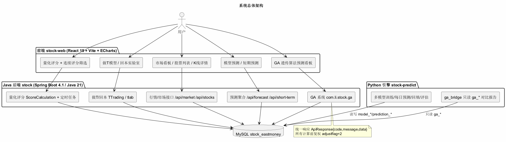
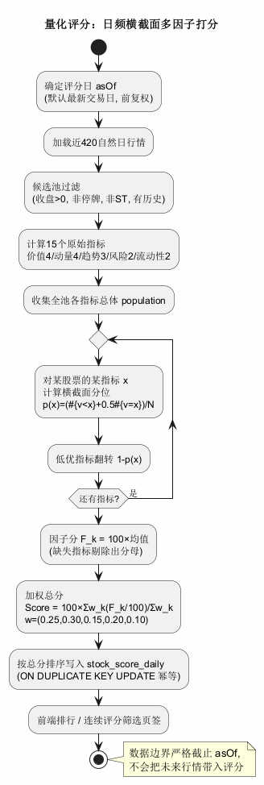
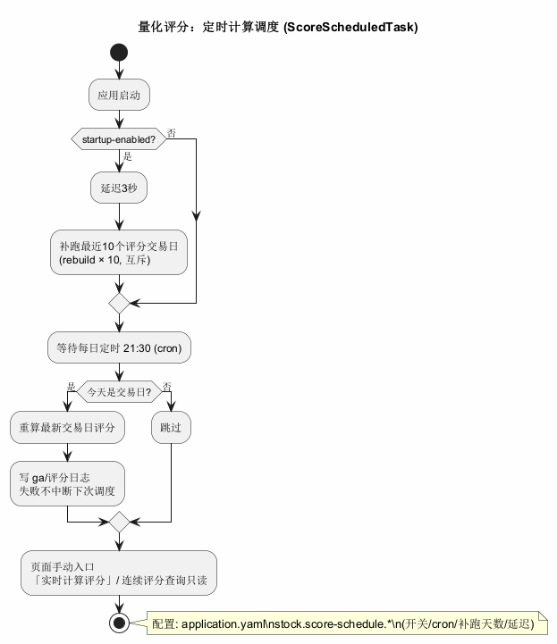
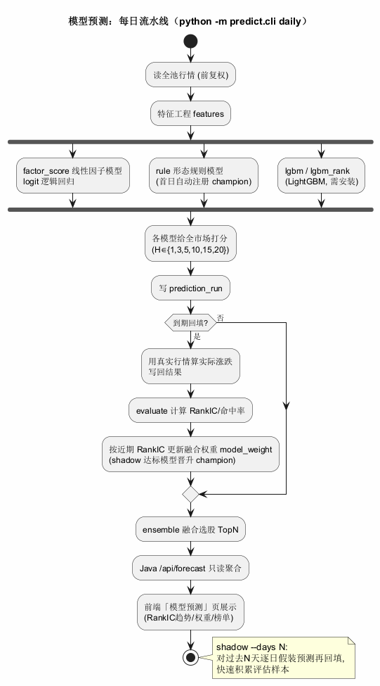
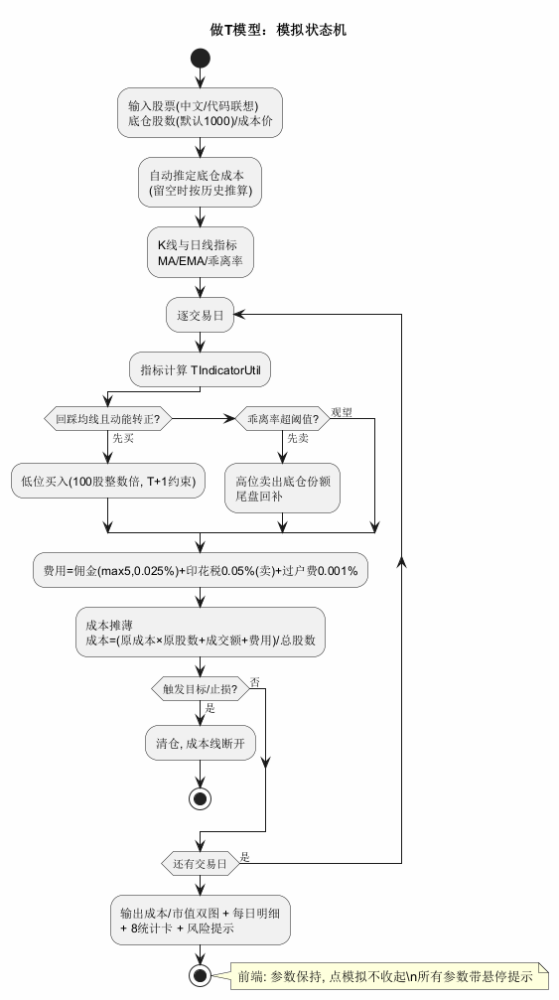
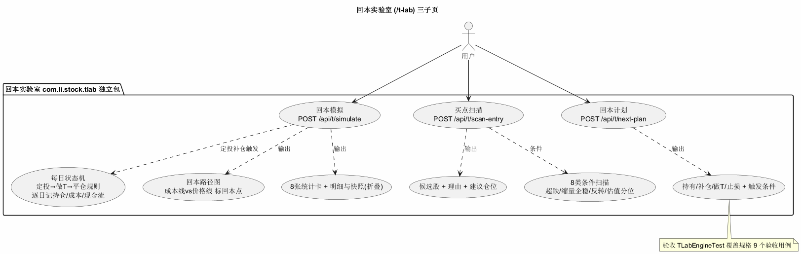
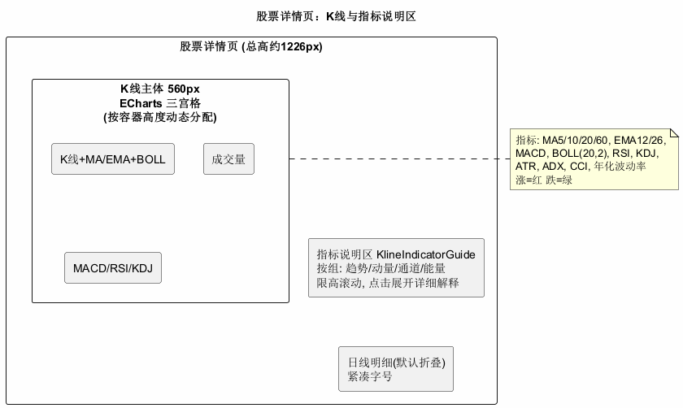
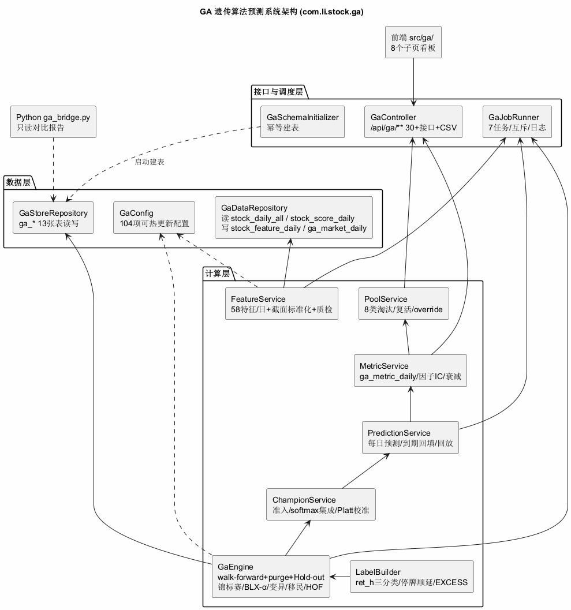
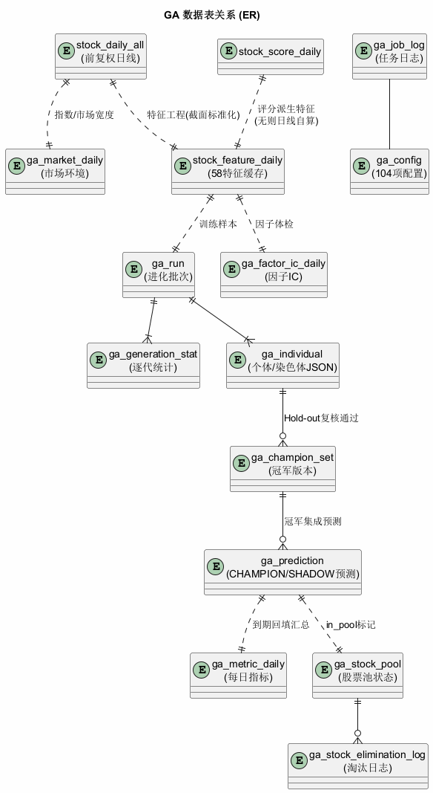
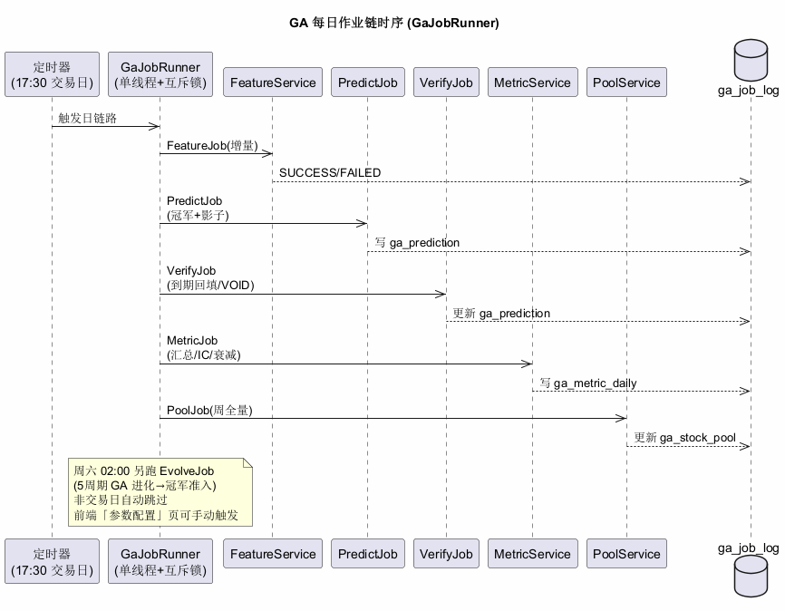

# 股票项目 功能与公式说明文档

> 适用版本：2026-11（量化评分 / 模型预测 / 短期预测 / 做T模型 / 回本实验室 / GA 遗传算法预测 全模块）
> 阅读对象：使用本系统看盘、复盘、研究的同学。
> 免责声明：所有评分、预测、模拟结果仅用于研究与复盘，**不构成投资建议**。

---

## 目录

1. [系统总览](#1-系统总览)
2. [数据层：表与口径](#2-数据层表与口径)
3. [量化评分（含连续评分筛选）](#3-量化评分)
4. [模型预测（Python 多模型引擎）](#4-模型预测)
5. [短期预测](#5-短期预测)
6. [做T模型（做T + 成本摊薄模拟）](#6-做t模型)
7. [回本实验室（/t-lab）](#7-回本实验室)
8. [K 线技术指标说明](#8-k-线技术指标)
9. [GA 遗传算法涨跌预测系统](#9-ga-遗传算法涨跌预测系统)
10. [附录 A：接口清单](#附录-a接口清单)
11. [附录 B：可调参数](#附录-b可调参数)
12. [附录 C：使用手册](#附录-c使用手册)

---

## 1. 系统总览

整套系统由三部分组成：

| 组成 | 目录 | 技术 | 职责 |
| --- | --- | --- | --- |
| Java 后端 | `D:\code\IdeaProject\stock\stock` | Spring Boot 4.1 / Java 21 / MyBatis + JdbcTemplate | 行情查询、量化评分、做T模拟、回本实验室、GA 系统、接口聚合 |
| React 前端 | `D:\code\WebStormProject\stock-web` | React 19 + Vite + ECharts | 全部页面：市场看板、K 线详情、模型预测、量化评分、做T、回本实验室、GA 看板 |
| Python 预测引擎 | `D:\code\PythonProject\stock-predict` | pandas / sklearn / lightgbm | 多模型训练、每日预测、到期回填、RankIC 评估、融合权重 |



页面与后端模块的对应关系：

| 前端页面 | 路由 | 后端接口前缀 | 说明文档章节 |
| --- | --- | --- | --- |
| 市场看板 | `/` | `/api/market` | — |
| 股票列表 / 详情 | `/stocks`、`/stocks/:code` | `/api/stocks` | 第 8 节 |
| 模型预测 | `/forecast` | `/api/forecast` | 第 4 节 |
| 短期预测 | `/short-term` | `/api/short-term` | 第 5 节 |
| 量化评分（含连续评分筛选页签） | `/score-ranking` | `/api/rankings` | 第 3 节 |
| 做T模型 | `/t-trading` | `/api/t-trading` | 第 6 节 |
| 回本实验室（做T模型2） | `/t-lab/*` | `/api/t` | 第 7 节 |
| 遗传算法预测 | `/ga/*` | `/api/ga` | 第 9 节 |
| 数据抓取 | `/data-crawler` | `/api/crawler` | — |

统一响应外壳（所有接口一致）：

```json
{ "code": 0, "message": "ok", "data": { }, "timestamp": 1794496523583 }
```

`code=0` 成功；`code=1` 业务错误；前端 `src/api/client.js` 会自动剥掉外壳，只把 `data` 交给页面。

---

## 2. 数据层：表与口径

### 2.1 行情分表与合并视图

日行情按板块拆成三张表，`stock_daily_all` 是三表的 UNION ALL 合并：

| 表 | 代码前缀 | 板块 |
| --- | --- | --- |
| `stock_daily_60` | 6 开头（60xxxx） | 沪市主板 |
| `stock_daily_30` | 3 开头（30xxxx） | 深市创业板 |
| `stock_daily_00` | 0 开头（00xxxx）及其他 | 深市主板等 |

**复权口径**：`adjustflag` 字段——`2`=前复权（默认口径）、`1`=不复权、`3`=后复权。
本系统所有计算（评分、做T、GA）统一使用 `adjustflag=2` 前复权，跨除权日的收益率计算才是连续可比的。

当前库内数据深度（2026-11-12 核对）：`stock_daily_all(adjustflag=2)` 覆盖
**2024-11-06 ~ 2026-11-12，共 490 个交易日、约 153 万行**，满足 GA 训练最低窗口
`T_min = 150` 交易日的要求。

### 2.2 其他核心表

| 表 | 用途 | 写入方 |
| --- | --- | --- |
| `stock_info` | 股票基础信息（代码、名称、交易所、ST 标记） | 爬虫 |
| `stock_score_daily` | 每日量化评分结果 | Java 评分任务（第 3 节） |
| `model_registry` / `model_weight` / `model_eval` / `prediction_run` | Python 预测引擎的模型注册、融合权重、评估指标、运行批次 | Python 引擎（第 4 节） |
| `ga_*`（13 张）+ `stock_feature_daily` | GA 遗传算法系统的全部状态 | Java GA 模块（第 9 节） |

---

## 3. 量化评分

### 3.1 评分原理：日频横截面多因子打分

**一句话**：每天把全市场符合条件的股票，按 15 个指标在「当天全体股票」里的相对位置打分，
再按五因子加权汇总成 0~100 的总分。

核心代码：`com.li.stock.service.ScoreCalculationService`。

**候选池（每天）**，同时满足：

1. 当天有行情且 `close > 0`（非停牌、非异常）；
2. `trade_status ≠ 0`；
3. 非 ST（`is_st ≠ 1`）；
4. 近 420 个自然日有足够历史数据（不足的指标记为缺失，不参与该因子）。

### 3.2 15 个指标与五因子分组

| 因子（权重） | 指标 | 方向 | 含义 |
| --- | --- | --- | --- |
| 价值 value（**0.25**） | `pe_ttm`、`pb_mrq`、`ps_ttm`、`pcf_ncf_ttm` | 越低越好 | 市盈/市净/市销/市现率，估值越便宜分越高 |
| 动量 momentum（**0.30**） | `ret21`、`ret63`、`ret126`、`ret252` | 越高越好 | 近 21/63/126/252 个交易日涨跌幅 |
| 趋势 trend（**0.15**） | `trend20`、`trend60`、`breakout120` | 越高越好 | 收盘价相对 20/60 日均线偏离、相对 120 日高点突破幅度 |
| 风险 risk（**0.20**） | `vol60`、`drawdown252` | vol 越低越好 / 回撤越大越好 | 60 日年化波动率、252 日内最大回撤（回撤深→便宜） |
| 流动性 liquidity（**0.10**） | `amount_ratio20`、`turnover20` | 越高越好 | 当日成交额相对 20 日均值倍数、20 日平均换手率 |

指标公式：

```text
ret_N      = C(t) / C(t-N) - 1              # N 日涨跌幅
trend_N    = C(t) / MA_N - 1                # 相对 N 日均线偏离
breakout120 = C(t) / max(C, 120日) - 1       # 相对 120 日最高收盘价
vol60      = std(daily_ret, 60) × √252 × 100   # 年化波动率(%)
drawdown252 = C(t) / min(C, 252日) - 1       # 距 252 日最低价的空间
amount_ratio20 = amount(t) / mean(amount, 20)
turnover20  = mean(turnover, 20)
```

### 3.3 打分公式（逐步）

**第 1 步：横截面分位数**。对每个指标，把当天全市场该指标的取值从小到大排序，
某只股票的分位数就是「它压过多少比例的对手」：

```text
p(x) = ( #{v < x} + 0.5 × #{v = x} ) / N
```

`#{v < x}` 是取值严格小于它的股票数、`#{v = x}` 是并列的股票数（并列算半票，避免并列名次跳变），`N` 是该指标当天有效股票总数。`p(x) ∈ (0, 1)`。

**第 2 步：方向翻转**。「越低越好」的指标（PE、PB、PS、PCF、波动率）直接取 `1 - p(x)`，
于是所有指标统一成「越大越好」的 0~1 分数。

**第 3 步：因子分**。一个因子内若干指标取算术平均，放大成百分制：

```text
F_k = 100 × ( 1 / m_k ) × Σ s_(k,i)
```

`m_k` 是第 k 个因子包含的指标数（value/momentum=4，trend=3，risk/liquidity=2）。
某指标缺失时直接从均值里剔除（分母自动缩小），所以数据缺失不会把分数拉低。

**第 4 步：加权总分**：

```text
Score = 100 × [ Σ w_k × (F_k / 100) ] / Σ w_k
```

权重 `w = (value 0.25, momentum 0.30, trend 0.15, risk 0.20, liquidity 0.10)`。
若某因子整体缺失，分子分母同时去掉该项（缺因子归一化），不会得 0 分。

**算例**（帮助理解量纲）：某股 value 因子 4 个指标翻转后分数为 0.90/0.70/0.80/0.60，
则 `F_value = 100 × (0.90+0.70+0.80+0.60)/4 = 75`；
若五因子分别为 75/60/50/65.5/40，
则 `Score = 100 × (0.25×0.75 + 0.30×0.60 + 0.15×0.50 + 0.20×0.655 + 0.10×0.40) / 1.0 = 62.35`。

> 数据边界严格截止到评分日（`asOfDate`），历史窗口不足的指标记缺失，**不会把未来行情带入评分**。



### 3.4 连续评分筛选（页签二）

**一句话**：找出「最近 N 天、每天总分都落在同一个分数带」的股票——持续强或持续弱的形态。

接口：`GET /api/rankings/scores/continuous`。

判定规则：

- 天数 `N ∈ {3, 5, 7, 10, 15, 20}`（最近 N 个**有评分的交易日**，不是自然日）；
- 分数带（左闭右开，`90+` 无上界）：
  `[0,30)`、`[30,50)`、`[50,60)`、`[60,75)`、`[75,90)`、`[90,∞)`；
- 命中条件：这 N 天里**每一天**的 `total_score` 都落在选中的同一个分数带内。

返回两块数据：

1. **6 档 × 6 个天数** 的命中矩阵（每格 = 该带该天数下命中的股票数）；
2. 选定档位/天数后的**分页明细**（代码、名称、最新分、区间分均值/最差、最近 N 天逐日分数）。

支持筛选全部主板 / 沪主板 / 创业板，排序可选「最新分」「区间均值」「区间最差」。
页面状态（选中的天数、档位、板块）会话内保持，切页签不丢。

### 3.5 评分自动计算（定时任务）

- **启动补跑**：服务启动 3 秒后，自动补算最近 10 个评分交易日；
- **每日定时**：每个交易日 21:30 重算当日评分（当日行情抓取完成后）；
- 实现：`ScoreScheduleService` + `ScoreScheduledTask`，结果 `ON DUPLICATE KEY UPDATE`
  写入 `stock_score_daily`（同日同股重算覆盖，幂等）；
- 配置在 `application.yaml` 的 `stock.score-schedule.*`（开关、cron、补跑天数）；
- 页面上的「实时计算评分」按钮仍是手动触发入口（按当日或指定日期重算一次）。



### 3.6 怎么用

1. 侧栏「量化评分」→ 默认进「量化评分排行」页签：看当日总分排行、五因子分列；
2. 点「评分规则」按钮弹出公式弹窗（不影响页面任何状态）；
3. 切「连续评分筛选」页签：先看矩阵热区（哪个带在哪个天数上股票扎堆），再点选格看明细；
4. 常见用法：`75~90` 带 × `连续 10 天` ≈ 近期持续强势池；`0~30` 带 × `连续 5 天` ≈ 持续弱势池。

---

## 4. 模型预测

### 4.1 原理：多模型并行 + RankIC 融合

Python 引擎（`D:\code\PythonProject\stock-predict`）维护一个**模型池**，每个模型独立给
全市场股票打「未来 H 日看涨概率/分数」，再按近期预测能力（RankIC）加权融合成最终榜单。

模型类型（`predict/models/`）：

| 模型 | 类型 | 原理 |
| --- | --- | --- |
| `factor_score` | 线性因子 | 多因子线性加权打分，可解释性最强的基线 |
| `logit` | 逻辑回归 | 在标准化特征上拟合 P(未来H日跑赢) |
| `rule` | 形态规则 | 无需训练的技术形态规则（首日自动注册为 champion） |
| `lgbm` | LightGBM 回归/分类 | 梯度提升树，非线性主力模型（需 `pip install lightgbm`） |
| `lgbm_rank` | LightGBM 排序 | 以排序目标（LambdaRank 思路）训练，直接优化名次 |

预测周期 `H ∈ {1, 3, 5, 10, 15, 20}` 交易日。

### 4.2 每日流水线（`python -m predict.cli daily`）

```text
特征(features) → 各模型打分 → 融合选股(ensemble) → 到期回填 → 评估(evaluate) → 权重/晋升
```

- **回填**：某天的预测到期（过了 H 个交易日）后，用真实行情算出「实际是否跑赢」，
  写回 `prediction_run` 供评估；
- **评估**：`evaluate.py` 按到期批次计算每个模型的 **RankIC**（预测分数与实际收益的
  横截面秩相关）、命中率、多空收益等，写入 `model_eval`；
- **影子运行**（`shadow --days N`）：对过去 N 天逐日「假装预测再回填」，快速积累评估样本
  而不用等真实时间流逝；上线新模型先跑影子，验证有效再晋升 `champion`；
- **融合**：`ensemble.py` 用各 champion 模型近期 RankIC 的 softmax 权重融合，
  权重写入 `model_weight`，前端「融合权重」图的数据来源。

### 4.3 前端页面与 Java 接口

Java 后端 `/api/forecast/**` 只做**聚合查询**（读 Python 写的表），不参与训练：

- 预测榜单：最新一天各模型 / 融合的 Top N 股票与分数；
- 模型表现：RankIC 趋势、命中率、多空对比；
- 融合权重：当前各 champion 模型权重；
- 点击股票跳 K 线详情，返回时回到模型预测页。

页面附「模型解释」区：每个模型类型、参数含义、评估指标怎么读都写在页面上。



### 4.4 怎么用

1. 保证 Python 引擎每日 `daily` 已跑（或手动补跑历史 `shadow`）；
2. 打开「模型预测」页：先看融合榜单再看单模型；
3. 看「模型表现」：RankIC 均值持续 > 0.02 的模型才有参考价值；权重是自动按表现分配的；
4. 详情可看《使用教程.md》（Python 项目根目录）。

---

## 5. 短期预测

`ShortTermForecastService` + 前端「短期预测」页：在量化评分因子 + 技术指标的基础上，
用近期有效性加权给出**未来 1~5 个交易日**的方向倾向与置信度，并把每日预测留痕
（`ShortTermForecastHistoryService`），到期同样自动回填核对，形成短期预测的胜率统计。
适合和「模型预测」的更长周期结论互相印证。

---

## 6. 做T模型

页面「做T模型」（`/t-trading`，接口 `/api/t-trading`）。核心代码：
`TTradingService` / `TTradingStrategyEngine` / `TTradingSimulator` / `TIndicatorUtil`。

**一句话**：输入一只股票的底仓与成本价，系统按分钟/日级模拟做T（先买后卖 / 先卖后买），
叠加费用后逐日更新成本，展示「成本摊薄 → 回本」的全过程。

### 6.1 交易规则

- **T+1**：当日买入的份额次日才能卖；底仓部分当日可卖（先卖后 T）；
- **整手约束**：买入按 100 股整数倍；
- **费用模型**（买卖双向都按下面口径）：

```text
佣金     = max(5.0, 成交金额 × 佣金率 0.025%)      # 最低 5 元
印花税   = 成交金额 × 0.05%                        # 仅卖出收取
过户费   = 成交金额 × 0.001%                       # 沪市
```

- **成本摊薄**：每次买入按新的加权平均更新成本价；做T盈利会摊低底仓成本：

```text
买入后成本 = (原成本 × 原股数 + 成交价 × 买入股数 + 费用) / 总股数
清仓后成本线断开（成本不再延续，前端按断点处理）
```

### 6.2 策略信号（TIndicatorUtil）

以日线指标为参照，典型的做T信号：

- **先买后买回卖**：日内回踩 MA5/MA10 附近且分时动能转正 → 低位买入；
- **先卖后买**：冲高至偏离均线过远（如乖离率 bias = C/MA - 1 超阈值）→ 高位卖出、尾盘回补；
- 系统按信号逐日给出建议买卖份额，并输出每日计划与风险提示。

### 6.3 前端页面

- 股票输入支持**中文简称/代码**联想（复用 `/api/stocks/suggest`），默认贵州茅台；
- 默认底仓 1000 股、初始买入日期取近 7 天、模拟结束默认未来一个月；
- 所有参数带悬停提示；参数与结果会话内保持；
- 结果区：成本走势 + 持仓市值双图、每日明细表、快照与风险提示（默认折叠）；
- 点击开始模拟后参数面板**不收起**，方便边看边调参。



### 6.4 怎么用

1. 输入股票（中文或代码均可）→ 填底仓股数与成本价（留空则自动推定）；
2. 「开始模拟」→ 看成本线是否被逐步摊薄、何时回本；
3. 对照每日建议与费用明细评估策略质量。
4. 更细的设计说明见 `docs/做T.md`。

---

## 7. 回本实验室

路由 `/t-lab`（侧栏「做T模型2」），接口 `/api/t/**`。核心代码：`com.li.stock.tlab.*`
（独立包，与主业务零耦合）。三个子页：

### 7.1 回本模拟（Simulate）

输入：股票、底仓、成本价、月定投资金/频率、目标解套价等。

引擎按日推进状态机：每日先处理**定投补仓**（在低位阈值触发时买入），再做T、再按
止损/目标价规则平仓，逐日记录持仓、成本、市值、现金流；输出：

- 回本路径图（成本线 vs 价格线，标出回本点日期）；
- 8 张统计卡：总投入、当前市值、浮盈亏、回本所需涨幅、剩余天数预估等；
- 每日明细与交易快照（默认折叠）。

### 7.2 补仓/买点扫描（ScanEntry）

对全市场（或按池）扫描：按 8 类条件（超跌、缩量企稳、趋势反转、估值分位、连续评分
低位等）给出「适合补仓/建仓」的买点候选与理由、建议仓位。

### 7.3 回本计划（NextPlan）

对自选持仓逐只输出「下一步操作建议」：继续持有 / 补仓 / 做T降成本 / 止损，
附触发条件与参数。

**验收**：`TLabEngineTest` 覆盖规格书的 9 个验收用例（费用、T+1、整手、成本、
回本点、扫描命中、计划建议等）。



---

## 8. K 线技术指标

股票详情页（`/stocks/:code`）的 K 线图与「指标说明」区。点击指标名可展开详细解释。
颜色约定：**涨=红、跌=绿**（A 股口径）。

| 指标 | 公式（要点） | 解读 |
| --- | --- | --- |
| MA5 / MA10 / MA20 / MA60 | `MA_N = mean(C, N)` | 短期均线在上且多头排列=强势；价格跌破 MA5 常是短线走弱信号 |
| EMA12 / EMA26 | `EMA = α×C + (1-α)×EMA_prev, α=2/(N+1)` | 对近端价格反应更快，配合 MA 看趋势加速度 |
| MACD | `DIF=EMA12-EMA26; DEA=EMA(DIF,9); MACD=2×(DIF-DEA)` | DIF 上穿 DEA（金叉）看多；柱由绿转红是动能转强 |
| BOLL(20,2) | `MID=MA20; UPPER=MID+2σ; LOWER=MID-2σ` | 触上轨=超买区、触下轨=超卖区；开口放大=波动加剧 |
| RSI(6/12/24) | `100 × RS/(1+RS), RS=平均涨幅/平均跌幅` | >70 超买、<30 超卖；高位钝化说明趋势强 |
| KDJ(9,3,3) | 随机价格位置 %K 平滑得 %D、%J=3K-2D | J<0 超卖、J>100 超买；金叉位置越低越有效 |
| ATR(14) | Wilder 平滑的 TR 均值 | 真实波幅，用来定止损距离、判断行情活跃度 |
| ADX(14) | ±DI 差与和的比率再 Wilder 平滑 | >25 趋势明确（涨看 +DI，跌看 -DI），<20 震荡市慎用趋势信号 |
| CCI(20) | `(TP-MA(TP))/(0.015×MAD)` | >100 强势区、<-100 弱势区，极端值后回归 |
| 年化波动率 | `σ_daily × √252` | 与评分的 `vol60` 同源，衡量风险 |

> 详情页还提供：更高 K 线主体（560px，三宫格按容器高度动态分配）、
> 日线明细默认折叠、指标分组解释区（按趋势/动量/通道/能量分组，限高滚动），
> 整页高度从 1682px 压到约 1226px。



---

## 9. GA 遗传算法涨跌预测系统

页面「遗传算法预测」（`/ga/*`），接口 `/api/ga/**`。实现遵循
《股票遗传算法涨跌预测系统 需求与设计文档 v1.0》。
代码分布：Java 后端 `com.li.stock.ga`（规格建议 `com.quant.ga`，因启动类只扫
`com.li.stock`，按现有项目规范改为 `com.li.stock.ga`，其余不变）；
前端 `src/ga/`；Python 桥接 `predict/ga_bridge.py`。

### 9.1 核心思想

用**遗传算法（GA）在特征空间里搜索一个「特征加权打分规则」**：
每个个体（染色体）= 一组「选哪些特征 + 每个特征的权重 + 阈值」，
打分规则 `z = Σ w_i × x_i`，超过阈值判涨、否则判跌；
适应度按样本外（验证段）平衡准确率衡量——**进化是在找「最近这段行情里，
哪些特征的什么组合能区分涨跌」**，而不是拟合某个神经网络。

### 9.2 数据流与防未来函数

```text
stock_daily_all(前复权) ──┐
stock_score_daily(可选用) ─┼→ 特征工程(58特征/日, 截面标准化) → stock_feature_daily
指数行情 ─────────────────┘→ 市场环境 → ga_market_daily
                                     ↓
标签构建 ret_h = C(t+h)/C(t) - 1（停牌日顺延，EXCESS 模式减同日池内等权收益）
                                     ↓
GA 引擎(种群/锦标赛/BLX-α交叉/变异/移民/HOF) → ga_run / ga_individual
                                     ↓
冠军准入(Hold-out 复核) → ga_champion_set → 每日预测 → ga_prediction
                                     ↓
到期回填 → ga_metric_daily / ga_factor_ic_daily → 股票池淘汰 ga_stock_pool
```

防未来函数的关键设计：

- 所有特征、标签、切分都**以 asOf 日期为右边界**；
- walk-forward 折：训练段、验证段之间留 **purge 隔离带 = h 天**（训练段末尾 h 天
  的标签会用到验证段的行情，必须丢弃），Hold-out 段永远不参与进化；
- 特征截面标准化（当日全池 z-score + 1%/99% 缩尾）只用当日池内数据，不引入未来分布。

### 9.3 特征（v1 特征集，58 个）

| 类别 | 举例 |
| --- | --- |
| 动量 | ret5/10/20/60、距 52 周高低点、连涨天数 |
| 趋势 | MA 乖离、EMA 位置、通道位置（BOLL 内分位） |
| 波动/风险 | vol20/60、ATR 比、下行波动占比 |
| 量能 | 量比、换手分位、量价相关性、OBV 斜率 |
| 资金/统计 | AMihud 非流动性、偏度、峰度、beta_60（对市场日收益的滚动 beta） |
| 评分派生 | 当日/5日/20日量化总分与分位（历史无评分时从日线自算） |
| 市场环境 | 指数动量、市场波动、市场宽度（涨跌家数比）、regime 标记 |

评分表历史不足时，评分派生特征自动回退为日线自算，不影响其他特征。

### 9.4 标签

```text
ret_h(t) = C(t+h) / C(t) - 1        # 停牌日顺延到下一个有行情日
threshold(h, vol20) = max(|ret_h| 分位 70% , 0.5×vol20×√h)   # 三分类阈值
label:  +1 涨(ret > +θ) / 0 平(|ret| ≤ θ) / -1 跌(ret < -θ)
EXCESS 模式：ret 减去同日全池等权收益，衡量「跑赢大盘」
```

### 9.5 GA 算子与适应度

- **个体**：染色体 = `{特征索引→权重, 阈值}` JSON，最少激活 3 个特征；
- **初始种群**：部分先验个体（等权 + 高 IC 特征）+ 随机个体；
- **选择**：锦标赛（size 3）；
- **交叉**：BLX-α 混合（子代权重在父代区间 ±α 扩张内取值）；
- **变异**：高斯扰动权重 / 增删激活特征；
- **移民**：每代注入少量随机个体防早熟；
- **淘汰**：适应度绝对淘汰 + 名人堂（HOF）保留历史最优。

**适应度**（验证段平衡准确率 BalAcc 为主，惩罚过拟合与特征覆盖率）：

```text
F = F_va − k × max(0, F_tr − F_va) − c × (Σ m_i / N)
      F_va 验证段得分, F_tr 训练段得分
      k×(F_tr−F_va)  训练/验证落差惩罚（过拟合项）
      c×覆盖率        未激活特征占比惩罚（逼个体用更多特征）
BalAcc = (TPR + TNR) / 2
```

### 9.6 冠军准入与概率校准

进化结束后，当前代 HOF 前若干名进入 **Hold-out 复核**：

```text
准入条件：Hold-out BalAcc ≥ holdout_min_balacc(0.52)
          且 首段 BalAcc ≥ holdout_min_first(0.51)
```

通过才写入 `ga_champion_set`（CHAMPION 角色）；未通过的老冠军若近期衰减
（`retire_min_samples=3000` 样本后 BalAcc 掉到阈值下）自动退役。
每日预测由**冠军集成**完成：对 Hold-out 得分做 softmax 加权，每个冠军给出
`P(涨)`，再做 **Platt 校准**（logistic 校准把打分映射成真实概率），
输出 `pred_direction(+1/0/-1)`、`confidence`、正负贡献 Top10 特征。
另有 **SHADOW 影子模型** 每日同跑，累计满 `shadow 晋升阈值` 样本且表现达标时
自动晋升为冠军（无人工介入）。

### 9.7 每日作业链（定时任务）

`GaJobRunner`（单守护线程 + 每任务互斥锁，日志入 `ga_job_log`）：

| 任务 | 做什么 |
| --- | --- |
| FeatureJob | 增量构建当日特征与市场环境 |
| PredictJob | 冠军集成生成当日全池预测（CHAMPION + SHADOW） |
| VerifyJob | 到期预测回填实际涨跌（VOID 处理：到期日无行情则置 VOID） |
| MetricJob | 汇总每日命中/指标、因子 IC、冠军衰减检查 |
| PoolJob | 股票池淘汰/复活评估（每周全量） |
| EvolveJob | 周进化（5 个周期各跑一轮 GA，产出新冠军候选） |
| ReplayJob | 历史回放（指定区间逐日断点续跑，模拟当时只能看到的数据） |

默认日链路（交易日 17:30）顺序执行：Feature → Predict → Verify → Metric → Pool；
每周六 02:00 跑 EvolveJob。非交易日自动跳过。前端「参数配置」页可手动触发每个任务
并查看 `ga_job_log` 的最近结果。

### 9.8 股票池（8 类淘汰/复活规则）

| 规则 | 触发 | 结果 |
| --- | --- | --- |
| LONG_SUSPEND | 连续停牌 ≥ N 天 | 淘汰 |
| NO_TRADE_DATA | 行情缺口/长期无数据 | 淘汰 |
| NEW_LISTING | 上市不足 N 天 | 淘汰（等冷却） |
| DELIST_RISK | 面值退市/ST 风险 | 淘汰 |
| POOR_PREDICTABILITY | 近期命中显著差于平均（≥40 样本） | 淘汰 |
| POOR_LIQUIDITY | 成交额长期过低 | 淘汰 |
| 淘汰后复活 | 冷却期 + 近 20 天表现恢复 | 复活入池 |
| 手工 override | 页面操作（备注必填） | 淘汰/复活/白名单，写 `ga_stock_elimination_log` |

### 9.9 前端页面（`/ga`，共 8 个子页）

| 子页 | 内容 |
| --- | --- |
| 总览 | 各周期命中率、样本数、置信度分布、近 N 天趋势、月度日历热力 |
| 预测复盘 | 预测明细（方向/置信/实际/误差），按周期/板块/池筛选，CSV 导出 |
| 错误分析 | 分数桶×实际涨跌、可靠性曲线（按置信度分桶命中率）、混淆矩阵、最大错误 Top、分位数表 |
| 淘汰管理 | 股票池状态、原因分布、淘汰日志、手工 override |
| 进化监控 | run 列表、逐代适应度曲线、个体详情（染色体 JSON）、冠军版本与回滚 |
| 因子体检 | 各特征 IC 趋势与 decay 标记 |
| 每日选股 | 当日多周期共识选股（共识方向 × 置信度排序） |
| 参数配置 | `ga_config` 热更新、任务触发、任务日志 |







### 9.10 Python 桥接

`predict/ga_bridge.py`：只读 `ga_*` 表，提供 `check`（数据健康检查）、
`compare`（GA 与 Python 模型表现对比）、`report`（文本报告）三个 CLI 命令，
12 个单测（`predict/ga_bridge_test.py`）。

### 9.11 怎么用（重要）

**看板冷启动（推荐）**：后端启动后 60 秒会自动检查并跑一次 `InitJob`（`stock.ga.init-enabled`，
默认开）。它把最近 `init_days`（ga_config 全局项，默认 10）个交易日补成**实盘** `is_replay=0` 数据：
逐日生成 CHAMPION/SHADOW 预测 → `VerifyJob` 全量回填 → `MetricJob` 重建指标 → 逐日跑 5 个周期的
因子 IC → `PoolJob` 刷新股票池。窗口内数据齐了就直接跳过，因此实际只会执行一次；
在「后台任务」页手动运行 `InitJob` 同样幂等（跳过已有交易日、已 `VERIFIED` 行永不改写）。
数据来自当前活跃冠军集 + 真实历史特征/收盘价，属于「用现有模型回灌历史」，
用于让总览 / 趋势 / 日历 / 选股 / 分析 / 个股 / 因子页有内容，不应作为实盘业绩评估依据。
看板默认「仅实盘」只查 `is_replay=0`，历史回放 (`is_replay=1`) 数据需切换「含回放」查看。

**特征首次使用**：`FeatureJob` 会检查 `stock_feature_daily` 覆盖的交易日数，
不足 160 天时自动**回填全部历史特征**（本库约 490 个交易日、154 万行，耗时 3–5 分钟），
之后再运行则只增量补最近 7 天。`EvolveJob / WeeklyEvolve / 单周期进化` 在开跑前也会做同样的检查，
所以先点进化也不会再报「有效样本不足」。`InitJob` 内部也带同样的检查。

推荐顺序：

```text
① FeatureJob   回填特征（首次全量，之后增量）
② EvolveJob    进化 5 个周期（默认 200×60 代，每周期数分钟~数十分钟）
               ——若想快速看效果，可先把 pop_size 调到 60、max_gen 调到 12
③ PredictJob   冠军集生成当日预测（每周期约 4500 只股票）
④ PoolJob      股票池淘汰/复活（周维度）
⑤ VerifyJob    到期回填（当日预测要等 h 个交易日后才到期，属正常）
⑥ MetricJob    汇总指标，看板开始有数据
```

操作路径：前端「遗传算法预测」→「**后台任务**」页（独立标签），逐个点「立即运行」；
提交后页面会自动轮询 `jobs/status`，把运行→成功/失败与后端返回的结果摘要显示出来，
下方「运行历史」列出 `ga_job_log` 最近记录。同一页面还能看到定时调度（cron / 下次触发时间 /
运行时开关），并可用「按定时规则执行」立即跑一次与 `@Scheduled` 完全相同的链路。
「参数配置」页只负责 `ga_config` 参数（支持作用域切换、搜索、批量保存、恢复默认）。

定时触发有两层开关：配置文件 `stock.ga.enabled` 与页面运行时开关，两者都开时
（交易日 17:30 日链路、周六 02:00 进化）才会执行；手动「立即运行」始终不受开关影响。

**想要复盘数据**（看板上的命中率、可靠性曲线、错误分析）还需要历史回放，因为当日预测尚未到期：

```text
POST /api/ga/evolution/replay
{ "from": "2026-09-01", "to": "2026-11-06", "step": 10, "horizons": [5] }
```

回放按断点重跑 GA 并逐日预测、到期自动核对，跑完后再执行一次 `MetricJob` 即可看到准确率曲线。

**性能提示**：`application.yaml` 的 JDBC URL 已加 `rewriteBatchedStatements=true`，
批量写特征/预测提速约 20 倍；该参数同时要求写入前清洗 `NaN`（代码已在预测行构造处处理）。

---

## 附录 A：接口清单

### A.1 量化评分

| 方法 | 路径 | 说明 |
| --- | --- | --- |
| GET | `/api/rankings/scores` | 当日评分排行（分页、筛选） |
| POST | `/api/rankings/scores/build` | 手动重算指定日期评分 |
| GET | `/api/rankings/scores/continuous` | 连续评分矩阵 + 明细（N/档位/板块/排序/分页） |

### A.2 模型预测 / 短期预测

| 方法 | 路径 | 说明 |
| --- | --- | --- |
| GET | `/api/forecast/**` | 预测榜单、模型表现、融合权重（读 Python 写的表） |
| GET | `/api/short-term/**` | 短期预测与历史胜率 |

### A.3 做T模型 / 回本实验室

| 方法 | 路径 | 说明 |
| --- | --- | --- |
| GET | `/api/t-trading/defaults` | 做T默认参数 |
| POST | `/api/t-trading/simulate` | 做T + 成本摊薄模拟 |
| GET | `/api/t/params/default` | 回本实验室参数 |
| POST | `/api/t/simulate` | 回本模拟 |
| POST | `/api/t/scan-entry` | 补仓/买点扫描 |
| POST | `/api/t/next-plan` | 下一步操作建议 |

### A.4 GA 系统（`/api/ga`，共 30+ 个）

| 组 | 路径 | 说明 |
| --- | --- | --- |
| 看板 | `GET /overview`、`/overview/trend`、`/overview/calendar` | 总览、趋势、月历 |
| 预测 | `GET /predictions`、`/predictions/export` | 明细、CSV 导出 |
| 个股 | `GET /stock/{market}/{code}` | 个股预测历史与详情 |
| 分析 | `GET /analysis/buckets\|reliability\|confusion\|top-errors\|quantile` | 错误分析五件套 |
| 池 | `GET /pool`、`/pool/log`、`POST /pool/override` | 股票池与手工干预 |
| 进化 | `GET /evolution/runs`、`/evolution/runs/{id}/generations`、`/individuals`、`/champions`、`POST /evolution/replay`、`/champions/promote\|rollback` | 进化监控与干预 |
| 因子 | `GET /factors/ic` | 特征 IC |
| 选股 | `GET /picks` | 当日多周期共识选股 |
| 配置 | `GET /config`、`PUT /config` | `ga_config` 热更新 |
| 任务 | `GET /jobs/status`、`POST /jobs/run` | 查询/触发后台任务 |

全部接口统一 `ApiResponse` 外壳；分页参数 `page/size`；日期 `yyyy-MM-dd`。

## 附录 B：可调参数

- 评分定时：`application.yaml → stock.score-schedule.*`（开关/cron/补跑天数/延迟）；
- GA 全部阈值（种群 200、代数 60、purge=h、Hold-out 0.52/0.51、校准样本 500、
  淘汰规则阈值等 104 项）都在 **`ga_config` 表**（前端「参数配置」页可直接改，热生效）；
- GA 任务开关：`application.yaml → stock.ga.*`（`enabled=false` 只停定时，手动触发不受影响）。

## 附录 C：使用手册

1. **启动后端**：`stock` 项目 `./mvnw spring-boot:run`（默认 8080）；
2. **启动前端**：`stock-web` 项目 `npm run dev`（5173）；
3. **每日数据**：爬虫抓当日行情 →（可选）Python 引擎 `python -m predict.cli daily`；
4. **评分**：自动（21:30 定时 + 启动补跑 10 天），或页面手动重算；
5. **GA 首次初始化**：启动后自动跑一次 `InitJob`（或手动运行），按 9.11 节；需要重新进化模型时再按 9.11 的 6 步顺序手动跑；
6. 常见问题：
   - 看板空 / 趋势只有 1 个点 → 默认「仅实盘」只查 `is_replay=0`，
     先跑一次 `InitJob`（或切「含回放」看历史复盘）；特征缺失时 InitJob 会自动补 `FeatureJob`；
   - EvolveJob 提示「有效样本不足」→ 先跑 FeatureJob；
   - VerifyJob「没有待回填预测」→ 正常，预测要等 h 个交易日后到期；
   - 接口 500 → 看 `ga_job_log` 与后端日志定位具体任务。

---

*文档生成：2026-11-12；公式均与当前代码实现逐一核对。*
